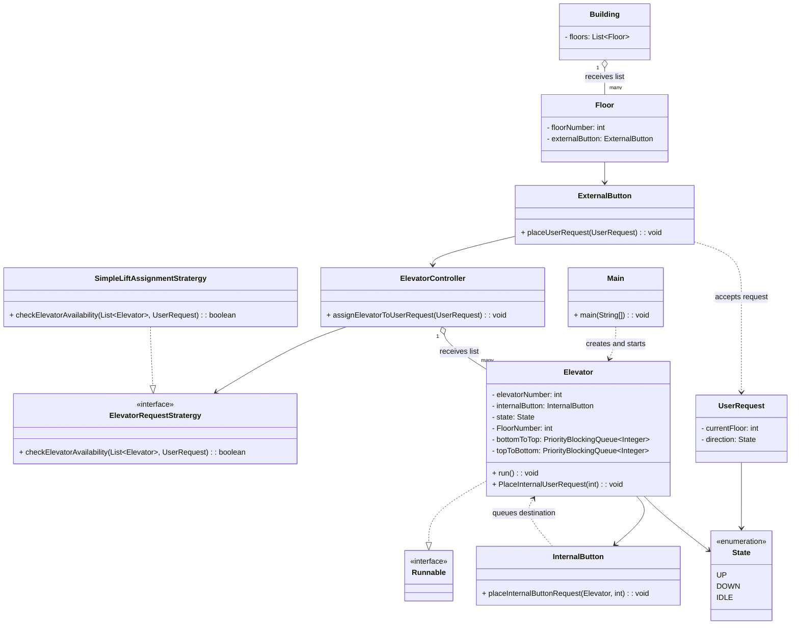
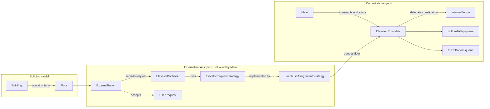
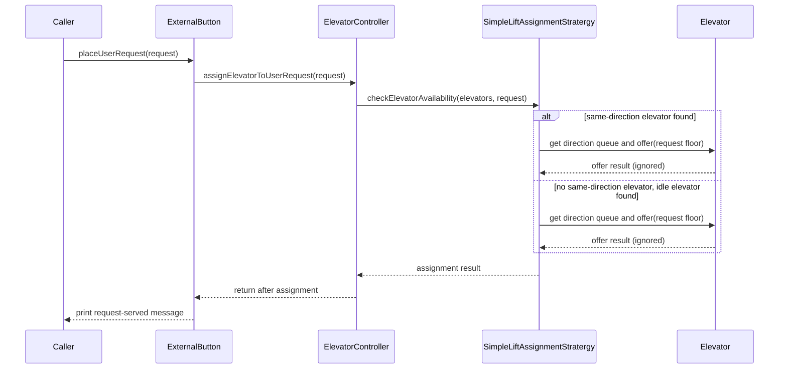

# ElevatorLLD

A lightweight Java elevator design focused on request assignment and direction-aware dispatch logic. The current implementation models several domain concepts such as floors, elevators, buttons, and user requests, and uses a strategy-based assignment flow to decide which elevator should serve a request.

## Table of contents

- [Project overview](#project-overview)
- [Directory structure](#directory-structure)
- [Important classes and responsibilities](#important-classes-and-responsibilities)
- [Class relationships](#class-relationships)
- [Component architecture](#component-architecture)
- [Execution flow](#execution-flow)
- [Architectural findings](#architectural-findings)

## Project overview

The codebase is a small object-oriented design rather than a complete elevator simulator. It centers on these responsibilities:

- receiving user requests,
- matching requests to an elevator based on direction and current state,
- storing destination requests in direction-specific priority queues,
- representing building, floor, and button entities.

The core design pattern visible in the code is the Strategy pattern, where [src/Interfaces/ElevatorRequestStratergy.java](src/Interfaces/ElevatorRequestStratergy.java) defines the assignment contract and [src/Stratergies/SimpleLiftAssignmentStratergy.java](src/Stratergies/SimpleLiftAssignmentStratergy.java) provides the concrete logic.

## Directory structure

- [src/Main.java](src/Main.java)
- [src/Controller/ElevatorController.java](src/Controller/ElevatorController.java)
- [src/Entities/Building.java](src/Entities/Building.java)
- [src/Entities/Elevator.java](src/Entities/Elevator.java)
- [src/Entities/ExternalButton.java](src/Entities/ExternalButton.java)
- [src/Entities/Floor.java](src/Entities/Floor.java)
- [src/Entities/InternalButton.java](src/Entities/InternalButton.java)
- [src/Entities/State.java](src/Entities/State.java)
- [src/Interfaces/ElevatorRequestStratergy.java](src/Interfaces/ElevatorRequestStratergy.java)
- [src/Request/UserRequest.java](src/Request/UserRequest.java)
- [src/Stratergies/SimpleLiftAssignmentStratergy.java](src/Stratergies/SimpleLiftAssignmentStratergy.java)

## Important classes and responsibilities

### [src/Main.java](src/Main.java)

- Responsibility: entry point of the project.
- Current implementation: creates two elevators with internal-button objects, places one internal destination request on each, wraps each elevator in a thread, and starts both threads.
- Architectural role: manually assembles and starts the current elevator runtime. It does not create a building or wire the external-request controller and assignment strategy.

### [src/Controller/ElevatorController.java](src/Controller/ElevatorController.java)

- Responsibility: coordinates the assignment of a user request to an elevator.
- Important fields:
  - `elevatorRequestStratergy`: the assignment strategy interface
  - `elevators`: list of managed elevators
- Important method:
  - `assignElevatorToUserRequest(UserRequest userRequest)`: repeatedly delegates availability checks until assignment succeeds.
- Dependency flow: depends on the strategy interface and the list of `Elevator` objects.

### [src/Interfaces/ElevatorRequestStratergy.java](src/Interfaces/ElevatorRequestStratergy.java)

- Responsibility: defines the contract for elevator assignment logic.
- Important method:
  - `checkElevatorAvailability(List<Elevator> elevatorList, UserRequest userRequest)`
- Architectural role: enables request-allocation logic to vary without changing the controller contract.

### [src/Stratergies/SimpleLiftAssignmentStratergy.java](src/Stratergies/SimpleLiftAssignmentStratergy.java)

- Responsibility: concrete assignment strategy.
- Important behavior:
  - first tries to find an elevator already moving in the same direction,
  - if not found, checks for an idle elevator,
  - queues the user request floor into the relevant elevator priority queue.
- Important private helpers:
  - `findSameDirectionElevator(...)`
  - `checkIdle(...)`
- Architectural role: this is the concrete implementation that the controller relies on.

### [src/Entities/Elevator.java](src/Entities/Elevator.java)

- Responsibility: models an individual elevator instance and its movement state.
- Important fields:
  - `elevatorNumber`
  - `internalButton`
  - `state` (`UP`, `DOWN`, or `IDLE`)
  - `FloorNumber`
  - `bottomToTop`
  - `topToBottom`
- Runtime behavior: implements `Runnable`; `run()` prints the elevator number and floor once per second until interrupted. It does not move the elevator or consume queued floors.
- Important methods:
  - `run()`
  - `PlaceInternalUserRequest(int floorNumber)`
  - `SetState(State state)`
  - `GetState()`
  - `SetFloor(int floorNo)`
  - `GetFloor()`
  - `getBottomToTop()` and `getTopToBottom()`
- Architectural role: this is the state-bearing runtime object that receives floor requests and stores them in direction-specific queues.

### [src/Entities/State.java](src/Entities/State.java)

- Responsibility: enum for movement state.
- Values: `UP`, `DOWN`, `IDLE`.
- Architectural role: central state model used by request assignment and elevator behavior.

### [src/Request/UserRequest.java](src/Request/UserRequest.java)

- Responsibility: represents a user request for an elevator.
- Important fields:
  - `currentFloor`
  - `direction`
- Important methods:
  - `getCurrentFloor()` / `setCurrentFloor(...)`
  - `getDirection()` / `setDirection(...)`
- Architectural role: the controller receives this object and the strategy evaluates its direction and starting floor.

### [src/Entities/Building.java](src/Entities/Building.java)

- Responsibility: models the building structure.
- Field:
  - `floors: List<Floor>`
- Architectural role: provides the aggregate container for floor entities.

### [src/Entities/Floor.java](src/Entities/Floor.java)

- Responsibility: represents a floor in the building.
- Fields:
  - `floorNumber`
  - `externalButton`
- Architectural role: floor objects are the source of external requests, and each floor is associated with an external button.

### [src/Entities/ExternalButton.java](src/Entities/ExternalButton.java)

- Responsibility: initiates an external user request.
- Important method:
  - `placeUserRequest(UserRequest userRequest)`
- Dependency flow: calls `elevatorController.assignElevatorToUserRequest(userRequest)`.
- Architectural role: acts as the edge between a physical floor interaction and the controller selection logic.

### [src/Entities/InternalButton.java](src/Entities/InternalButton.java)

- Responsibility: queues a destination inside an elevator.
- Important method:
  - `placeInternalButtonRequest(Elevator elevator, int internalButtonFloorNumber)`
- Behavior: inspects the elevator state and current floor, then adds the destination to either `bottomToTop` or `topToBottom`.
- Architectural role: represents destination selection inside the lift; the `Elevator` delegates to it from `PlaceInternalUserRequest(...)`.

## Class relationships

### Relationship summary



### Relationship details

1. Strategy relationship
   - [src/Controller/ElevatorController.java](src/Controller/ElevatorController.java) stores a dependency on [src/Interfaces/ElevatorRequestStratergy.java](src/Interfaces/ElevatorRequestStratergy.java).
   - [src/Stratergies/SimpleLiftAssignmentStratergy.java](src/Stratergies/SimpleLiftAssignmentStratergy.java) implements the interface.
   - Why it exists: to separate assignment logic from the controller so request selection can vary without rewriting controller behavior.
   - Type: dependency and interface implementation.

2. Aggregation relationship between building and floors
   - [src/Entities/Building.java](src/Entities/Building.java) owns a `List<Floor>` field.
  - Why it exists: the building groups floor objects supplied to its constructor.
  - Type: aggregation. The list is passed in; the code does not establish exclusive lifecycle ownership, so composition is not claimed.

3. Association between floor and external button
   - [src/Entities/Floor.java](src/Entities/Floor.java) contains an `ExternalButton` instance.
   - Why it exists: a floor is associated with a button used to submit elevator requests.
  - Type: direct association through a field.

4. Association between external button and controller
   - [src/Entities/ExternalButton.java](src/Entities/ExternalButton.java) receives a controller dependency in its constructor.
   - Why it exists: the button triggers controller assignment when a user request is placed.
   - Type: direct dependency/association.

5. Elevator state and request queue relationship
   - [src/Entities/Elevator.java](src/Entities/Elevator.java) keeps `bottomToTop` and `topToBottom` queues.
   - Why it exists: requests are grouped by direction and ordered by priority queue behavior.
   - Type: direct ownership of queue instances initialized by the elevator constructor.

6. Internal button dependency
   - [src/Entities/Elevator.java](src/Entities/Elevator.java) holds an `InternalButton`; it passes itself and a destination floor to `placeInternalButtonRequest(...)`.
   - Why it exists: the button applies the elevator’s state and floor to choose a destination queue.
   - Type: elevator-to-button association, with a button-to-elevator method dependency (the button does not retain an elevator field).

7. Controller-to-elevator relationship
   - [src/Controller/ElevatorController.java](src/Controller/ElevatorController.java) receives and stores a `List<Elevator>`.
   - Why it exists: the strategy scans those elevators to find a suitable one.
   - Type: aggregation/reference to a supplied collection; the source does not establish lifecycle ownership.

8. Object creation and wiring
   - [src/Main.java](src/Main.java) directly constructs `Elevator` and `InternalButton` instances and starts each elevator in a `Thread`.
   - The controller, strategy, building, floors, external buttons, and user requests are not instantiated by `Main` in the current entry point. No factory or dependency-injection framework is present.

## Component architecture



The assignment components describe an available method path in the source, not a workflow assembled by `Main`. The active entry point only starts elevator threads and places internal destination requests.

## Execution flow

### Current application startup and runtime

```mermaid
sequenceDiagram
  participant Main
  participant Elevator
  participant InternalButton
  participant Thread

  Main->>InternalButton: new InternalButton()
  Main->>Elevator: new Elevator(number, button)
  Main->>Elevator: PlaceInternalUserRequest(destination)
  Elevator->>InternalButton: placeInternalButtonRequest(this, destination)
  InternalButton->>Elevator: inspect state and current floor; enqueue destination
  Main->>Thread: new Thread(elevator)
  Main->>Thread: start()
  Thread->>Elevator: run()
  loop until interrupted
    Elevator-->>Thread: print elevator number and current floor
    Elevator->>Thread: sleep(1000)
  end
```

The queue insertion is real, but the current `run()` loop does not read those queues or update the elevator floor/state.

### External request assignment method path

This sequence documents the method interactions that are implemented, but this controller path is not constructed or called by the current `Main` method.



## Architectural findings

### Design pattern evidence

The project clearly demonstrates the Strategy pattern:

- [src/Interfaces/ElevatorRequestStratergy.java](src/Interfaces/ElevatorRequestStratergy.java) defines a single assignment contract.
- [src/Stratergies/SimpleLiftAssignmentStratergy.java](src/Stratergies/SimpleLiftAssignmentStratergy.java) implements it with direction-aware selection logic.
- [src/Controller/ElevatorController.java](src/Controller/ElevatorController.java) depends on the interface rather than a concrete assignment class.

### Separation of concerns

The code separates concerns in a simple but visible way:

- domain model: `Building`, `Floor`, `Elevator`, `State`, `UserRequest`
- interaction model: `ExternalButton`, `InternalButton`
- control layer: `ElevatorController`
- strategy layer: `ElevatorRequestStratergy` and `SimpleLiftAssignmentStratergy`

This is a clean layering for a small prototype, but it is not yet a full production elevator system.

### Current implementation limitations

The current codebase has several important architectural limitations that matter for accuracy:

- [src/Main.java](src/Main.java) starts two elevator threads and places internal destination requests, but does not instantiate a building or wire external-request assignment.
- `Elevator.run()` only prints the current floor and sleeps; it does not move between floors, consume either queue, or change the elevator state.
- The elevator assignment loop in [src/Controller/ElevatorController.java](src/Controller/ElevatorController.java) uses a busy loop: it repeatedly calls the strategy until an assignment succeeds, without a time-based or state-based exit condition beyond the assignment result.
- The controller/strategy external-request path exists in methods but is not exercised by the current entry point.
### SOLID and coupling observations

- Dependency inversion is present in the assignment path: `ElevatorController` depends on `ElevatorRequestStratergy`, while `SimpleLiftAssignmentStratergy` implements that contract.
- Responsibilities are split among the controller, strategy, elevator, and button classes. The controller also owns a retry loop, coupling request handling to an indefinite busy-wait policy.
- `ExternalButton` retains a controller reference, and `Elevator` retains an internal-button reference. These are direct associations; the current `Main` manually constructs only the elevator/button runtime.
- No factory or dependency-injection framework is present. The controller assignment graph is not assembled by the current entry point.

## Final verification notes

This document is at the repository root and links to the source files with relative Markdown paths. The current repository has no root `README.md`, so no README was created or modified. The diagrams distinguish the active `Main` workflow from the external-request method path that is implemented but not currently wired into startup.
