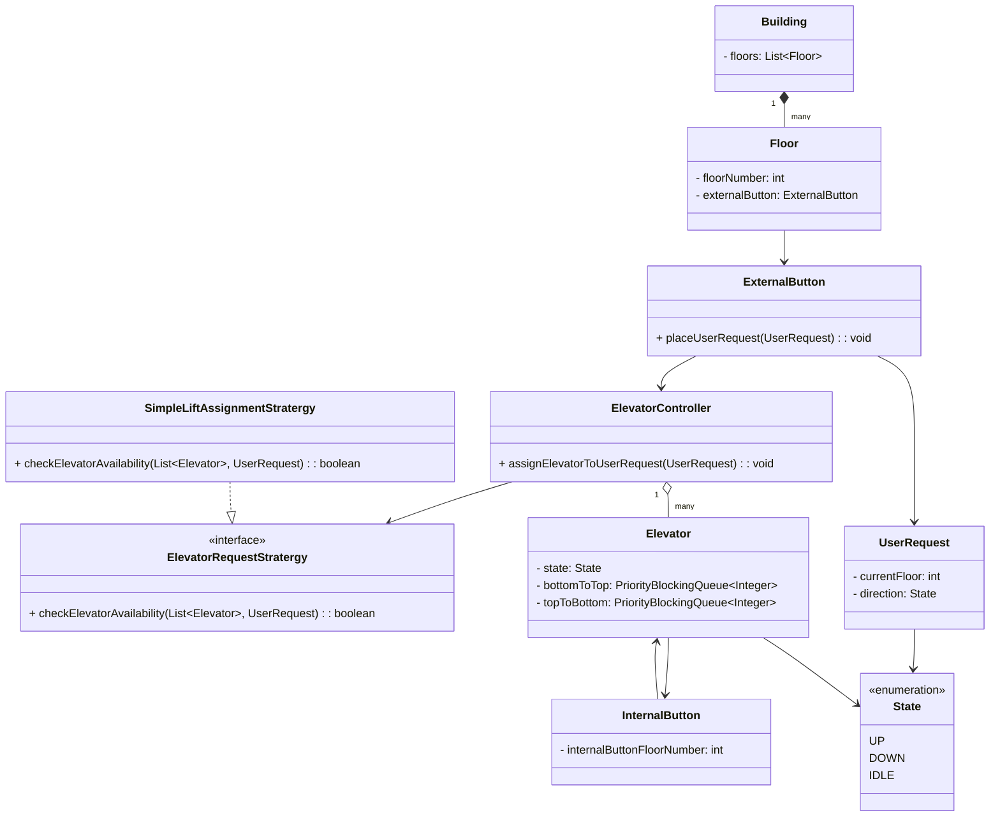
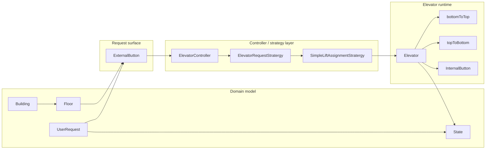
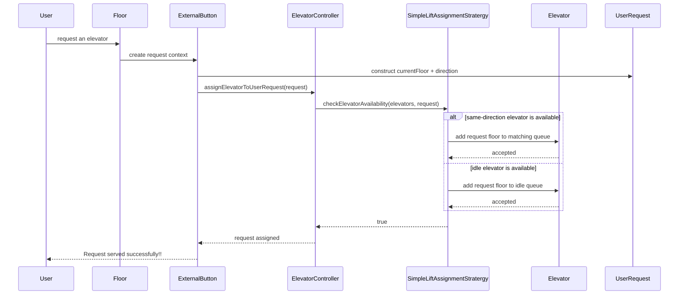
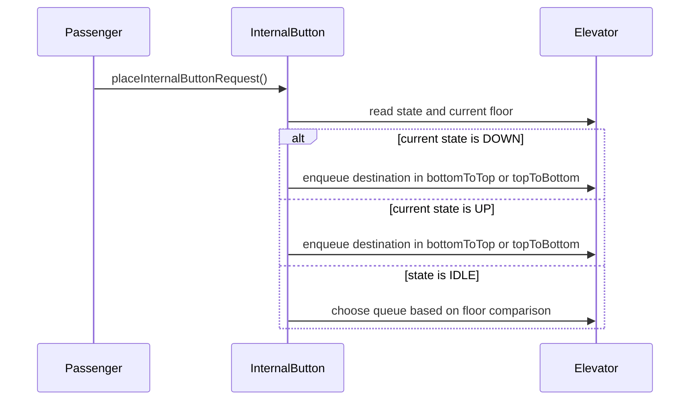

# ElevatorLLD

A lightweight Java elevator design focused on request assignment and direction-aware dispatch logic. The current implementation models several domain concepts such as floors, elevators, buttons, and user requests, and uses a strategy-based assignment flow to decide which elevator should serve a request.

## Table of contents

- [Project overview](#project-overview)
- [Directory structure](#directory-structure)
- [Important classes and responsibilities](#important-classes-and-responsibilities)
- [Class relationships](#class-relationships)
- [Component architecture](#component-architecture)
- [Execution flow](#execution-flow)
- [Architectural findings](#architectural-findings)

## Project overview

The codebase is a small object-oriented design rather than a complete elevator simulator. It centers on these responsibilities:

- receiving user requests,
- matching requests to an elevator based on direction and current state,
- tracking elevator movement through direction-specific priority queues,
- representing building, floor, and button entities.

The core design pattern visible in the code is the Strategy pattern, where [src/Interfaces/ElevatorRequestStratergy.java](src/Interfaces/ElevatorRequestStratergy.java) defines the assignment contract and [src/Stratergies/SimpleLiftAssignmentStratergy.java](src/Stratergies/SimpleLiftAssignmentStratergy.java) provides the concrete logic.

## Directory structure

- [src/Main.java](src/Main.java)
- [src/Controller/ElevatorController.java](src/Controller/ElevatorController.java)
- [src/Entities/Building.java](src/Entities/Building.java)
- [src/Entities/Elevator.java](src/Entities/Elevator.java)
- [src/Entities/ExternalButton.java](src/Entities/ExternalButton.java)
- [src/Entities/Floor.java](src/Entities/Floor.java)
- [src/Entities/InternalButton.java](src/Entities/InternalButton.java)
- [src/Entities/State.java](src/Entities/State.java)
- [src/Interfaces/ElevatorRequestStratergy.java](src/Interfaces/ElevatorRequestStratergy.java)
- [src/Request/UserRequest.java](src/Request/UserRequest.java)
- [src/Stratergies/SimpleLiftAssignmentStratergy.java](src/Stratergies/SimpleLiftAssignmentStratergy.java)

## Important classes and responsibilities

### [src/Main.java](src/Main.java)

- Responsibility: entry point of the project.
- Current implementation: contains a minimal main method that prints `Elevator LLD design`.
- Architectural role: demonstrates the project’s startup point, but does not instantiate the system model in its current form.

### [src/Controller/ElevatorController.java](src/Controller/ElevatorController.java)

- Responsibility: coordinates the assignment of a user request to an elevator.
- Important fields:
  - `elevatorRequestStratergy`: the assignment strategy interface
  - `elevators`: list of managed elevators
- Important method:
  - `assignElevatorToUserRequest(UserRequest userRequest)`: repeatedly delegates availability checks until assignment succeeds.
- Dependency flow: depends on the strategy interface and the list of `Elevator` objects.

### [src/Interfaces/ElevatorRequestStratergy.java](src/Interfaces/ElevatorRequestStratergy.java)

- Responsibility: defines the contract for elevator assignment logic.
- Important method:
  - `checkElevatorAvailability(List<Elevator> elevatorList, UserRequest userRequest)`
- Architectural role: enables request-allocation logic to vary without changing the controller contract.

### [src/Stratergies/SimpleLiftAssignmentStratergy.java](src/Stratergies/SimpleLiftAssignmentStratergy.java)

- Responsibility: concrete assignment strategy.
- Important behavior:
  - first tries to find an elevator already moving in the same direction,
  - if not found, checks for an idle elevator,
  - queues the user request floor into the relevant elevator priority queue.
- Important private helpers:
  - `findSameDirectionElevator(...)`
  - `checkIdle(...)`
- Architectural role: this is the concrete implementation that the controller relies on.

### [src/Entities/Elevator.java](src/Entities/Elevator.java)

- Responsibility: models an individual elevator instance and its movement state.
- Important fields:
  - `elevatorNumber`
  - `internalButton`
  - `state` (`UP`, `DOWN`, or `IDLE`)
  - `FloorNumber`
  - `bottomToTop`
  - `topToBottom`
- Important methods:
  - `SetState(State state)`
  - `GetState()`
  - `SetFloor(int floorNo)`
  - `GetFloor()`
  - `getBottomToTop()` and `getTopToBottom()`
- Architectural role: this is the state-bearing runtime object that receives floor requests and stores them in direction-specific queues.

### [src/Entities/State.java](src/Entities/State.java)

- Responsibility: enum for movement state.
- Values: `UP`, `DOWN`, `IDLE`.
- Architectural role: central state model used by request assignment and elevator behavior.

### [src/Request/UserRequest.java](src/Request/UserRequest.java)

- Responsibility: represents a user request for an elevator.
- Important fields:
  - `currentFloor`
  - `direction`
- Important methods:
  - `getCurrentFloor()` / `setCurrentFloor(...)`
  - `getDirection()` / `setDirection(...)`
- Architectural role: the controller receives this object and the strategy evaluates its direction and starting floor.

### [src/Entities/Building.java](src/Entities/Building.java)

- Responsibility: models the building structure.
- Field:
  - `floors: List<Floor>`
- Architectural role: provides the aggregate container for floor entities.

### [src/Entities/Floor.java](src/Entities/Floor.java)

- Responsibility: represents a floor in the building.
- Fields:
  - `floorNumber`
  - `externalButton`
- Architectural role: floor objects are the source of external requests, and each floor is associated with an external button.

### [src/Entities/ExternalButton.java](src/Entities/ExternalButton.java)

- Responsibility: initiates an external user request.
- Important method:
  - `placeUserRequest(UserRequest userRequest)`
- Dependency flow: calls `elevatorController.assignElevatorToUserRequest(userRequest)`.
- Architectural role: acts as the edge between a physical floor interaction and the controller selection logic.

### [src/Entities/InternalButton.java](src/Entities/InternalButton.java)

- Responsibility: queues a destination inside an elevator.
- Important method:
  - `placeInternalButtonRequest()`
- Behavior: inspects the elevator state and current floor, then adds the destination to either `bottomToTop` or `topToBottom`.
- Architectural role: represents passenger-driven destination selection inside the lift.

## Class relationships

### Relationship summary

### Relationship details

1. Strategy relationship
   - [src/Controller/ElevatorController.java](src/Controller/ElevatorController.java) stores a dependency on [src/Interfaces/ElevatorRequestStratergy.java](src/Interfaces/ElevatorRequestStratergy.java).
   - [src/Stratergies/SimpleLiftAssignmentStratergy.java](src/Stratergies/SimpleLiftAssignmentStratergy.java) implements the interface.
   - Why it exists: to separate assignment logic from the controller so request selection can vary without rewriting controller behavior.
   - Type: dependency and interface implementation.

2. Composition / aggregation relationship between building and floors
   - [src/Entities/Building.java](src/Entities/Building.java) owns a `List<Floor>` field.
   - Why it exists: the building is conceptually composed of floors.
   - Type: aggregation/composition-like containment, using a list field directly in the domain model.

3. Association between floor and external button
   - [src/Entities/Floor.java](src/Entities/Floor.java) contains an `ExternalButton` instance.
   - Why it exists: a floor is associated with a button used to submit elevator requests.
   - Type: strong local association.

4. Association between external button and controller
   - [src/Entities/ExternalButton.java](src/Entities/ExternalButton.java) receives a controller dependency in its constructor.
   - Why it exists: the button triggers controller assignment when a user request is placed.
   - Type: direct dependency/association.

5. Elevator state and request queue relationship
   - [src/Entities/Elevator.java](src/Entities/Elevator.java) keeps `bottomToTop` and `topToBottom` queues.
   - Why it exists: requests are grouped by direction and processed in floor order by priority queue behavior.
   - Type: composition within the elevator object.

6. Internal button dependency
   - [src/Entities/InternalButton.java](src/Entities/InternalButton.java) holds a reference to an `Elevator`.
   - Why it exists: the internal button contributes destination requests to the elevator’s internal queue.
   - Type: direct association.

## Component architecture

This component view reflects the actual architecture present in the code: domain objects define building and floor concepts, external interaction reaches the controller, the controller delegates request matching to a strategy, and the elevator holds state and directional queues.

## Execution flow

### External request flow

### Internal button flow

## Architectural findings

### Design pattern evidence

The project clearly demonstrates the Strategy pattern:

- [src/Interfaces/ElevatorRequestStratergy.java](src/Interfaces/ElevatorRequestStratergy.java) defines a single assignment contract.
- [src/Stratergies/SimpleLiftAssignmentStratergy.java](src/Stratergies/SimpleLiftAssignmentStratergy.java) implements it with direction-aware selection logic.
- [src/Controller/ElevatorController.java](src/Controller/ElevatorController.java) depends on the interface rather than a concrete assignment class.

### Separation of concerns

The code separates concerns in a simple but visible way:

- domain model: `Building`, `Floor`, `Elevator`, `State`, `UserRequest`
- interaction model: `ExternalButton`, `InternalButton`
- control layer: `ElevatorController`
- strategy layer: `ElevatorRequestStratergy` and `SimpleLiftAssignmentStratergy`

This is a clean layering for a small prototype, but it is not yet a full production elevator system.

### Current implementation limitations

The current codebase has several important architectural limitations that matter for accuracy:

- [src/Main.java](src/Main.java) does not instantiate a real building or elevator configuration; it only prints a message.
- The elevator assignment loop in [src/Controller/ElevatorController.java](src/Controller/ElevatorController.java) uses a busy loop: it repeatedly calls the strategy until an assignment succeeds, without a time-based or state-based exit condition beyond the assignment result.
- [src/Entities/Elevator.java](src/Entities/Elevator.java) stores data structures for requests but does not implement the actual movement loop, floor traversal, or dispatch scheduling.
- The project currently models request assignment and queue placement, not end-to-end elevator motion.

### SOLID and coupling observations

- Single Responsibility: each class is focused on a narrow responsibility, with the exception of a few small domain entities that are intentionally simple.
- Dependency inversion: the controller depends on the strategy interface rather than a concrete assignment implementation.
- Tight coupling: the design is structurally simple, but several classes are tightly coupled through direct constructor-based dependencies, such as `ExternalButton` to `ElevatorController` and `InternalButton` to `Elevator`.
- No factory or dependency injection framework is present; object creation is direct and manual.

## Final verification notes

This file is located at the repository root as `ARCHITECTURE.md`.

The Markdown uses relative links for source files and Mermaid blocks for class, component, and sequence views. No README file exists in this workspace, so no README update was created because the prompt specifically instructs not to create one unless it already exists.
